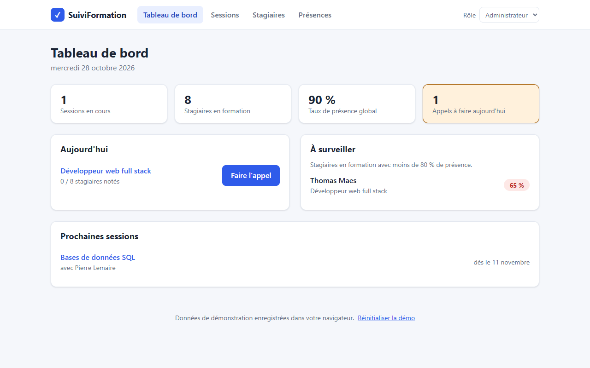
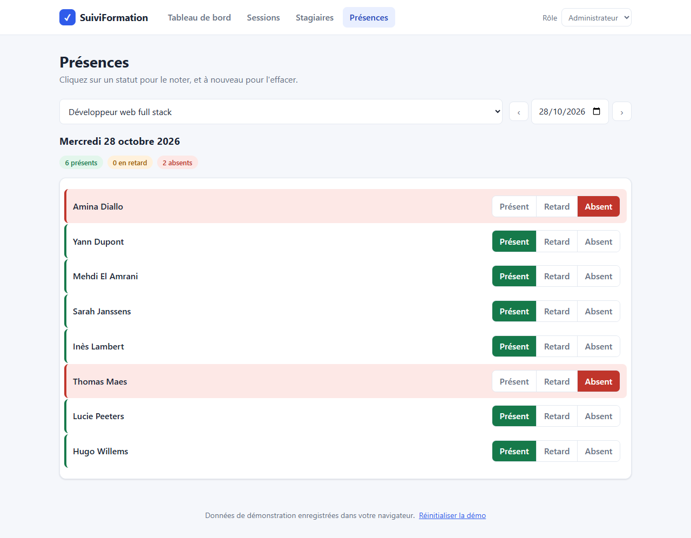
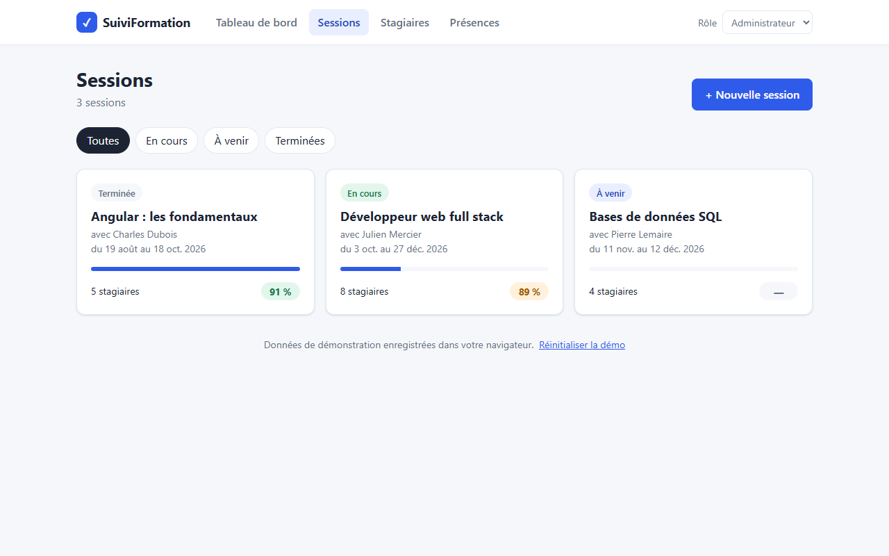
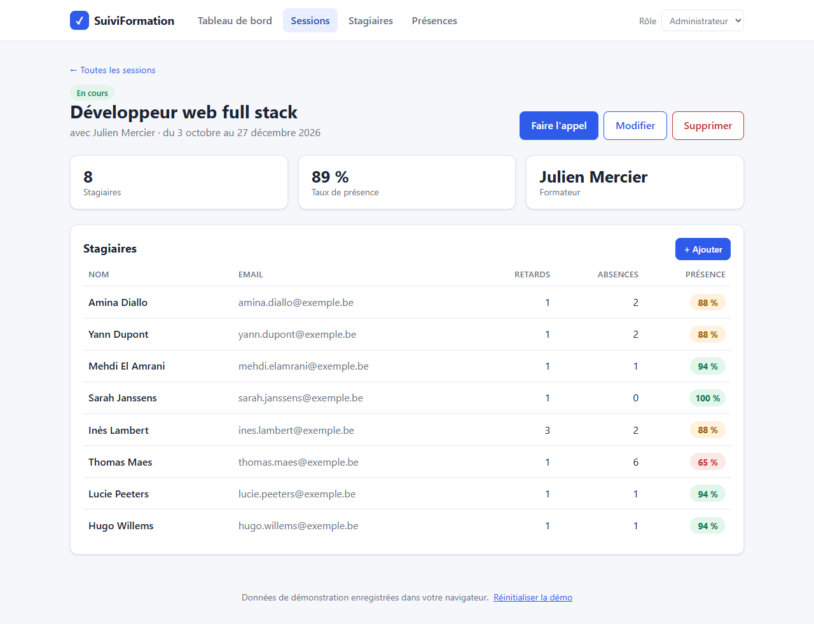
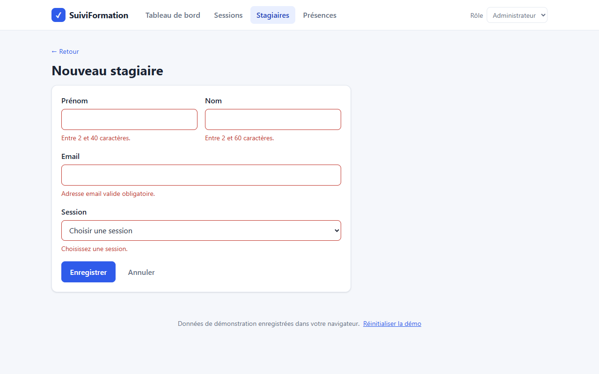
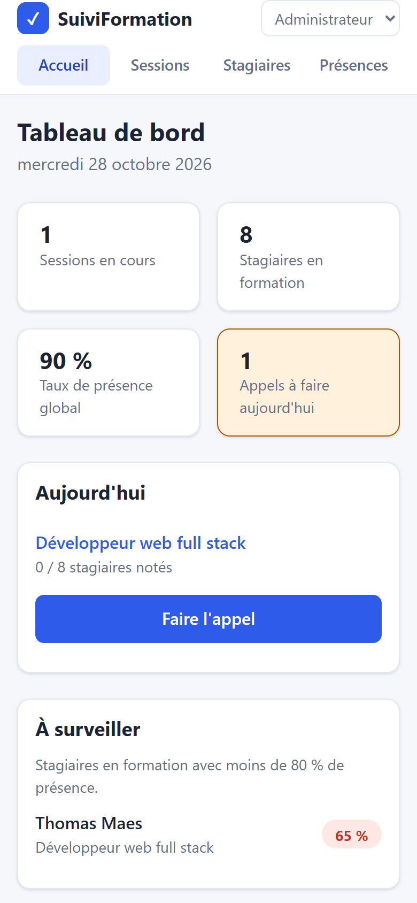
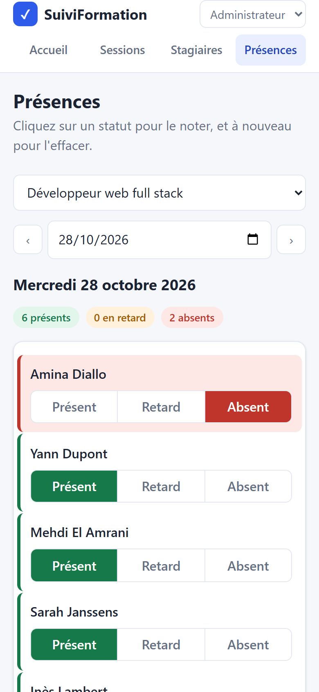
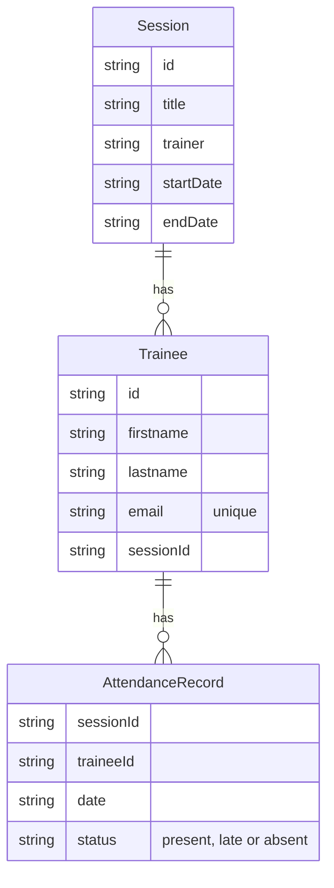

# ✓ SuiviFormation

**An Angular app to follow training sessions, trainees and daily attendance.**
*Application Angular de suivi des formations, des stagiaires et des présences.*

### 👉 [Try the live demo](https://puremax-lab.github.io/SuiviFormation/)

No account needed: the demo opens with sample data. Use the **Rôle** menu at the top right to switch between **Administrateur** (can create, edit and delete) and **Formateur** (can only take attendance).




## In short

| | |
|---|---|
| **What it does** | Training centres plan sessions, register trainees and take attendance every day. Attendance rates are calculated automatically |
| **What it shows** | A modern Angular app: standalone components, signals, reactive forms, routing with a guard, unit tests and automatic deployment |
| **Stand-out feature** | One-click attendance (present, late or absent), and a dashboard that flags trainees under 80 % attendance |
| **Status** | Deployed online, responsive on phones and desktops, covered by automated tests |

## Features

- **Dashboard**: key figures, today's attendance to take, trainees to watch, upcoming sessions
- **Sessions**: list filtered by status (ongoing, upcoming, finished), progress bar, attendance rate, detail page
- **Trainees**: search (accents ignored), filter by session, add, edit and delete
- **Attendance**: pick a session and a day, then one click per trainee, with an "everyone is present" button
- **Two roles**: admins manage the data, trainers only take attendance
- **Saved in the browser**: changes are kept in `localStorage`, and a link resets the demo data

## Screenshots

| Attendance | Sessions |
|---|---|
|  |  |

| Session detail | Form validation |
|---|---|
|  |  |

| Mobile: dashboard | Mobile: attendance |
|---|---|
|  |  |

## Technical highlights

**Angular**
- **Standalone components** and the new control flow (`@if`, `@for`), with no NgModule.
- **Signals** for all the state (`signal`, `computed`, `input()`): pages update by themselves when the data changes.
- **Lazy-loaded routes**: each page is downloaded only when it is opened.
- **URL parameters bound to inputs** (`withComponentInputBinding`): the attendance page reads `?session=` and `?date=` from the URL, so it can be bookmarked or shared.
- **Page titles** with a custom `TitleStrategy`, and French date formats with `LOCALE_ID`.

**Architecture**
- **A single store** ([`TrainingStore`](src/app/core/training-store.ts)) keeps sessions, trainees and attendance in signals and saves every change to `localStorage`. Deleting a session or a trainee also deletes the related attendance.
- **Route guard** ([`adminGuard`](src/app/core/role.ts)): a trainer who opens a create or edit page is sent back to the dashboard.
- **Demo data relative to today** ([`demo-data.ts`](src/app/core/demo-data.ts)): the demo always shows an ongoing, a finished and an upcoming session.

**Forms**
- **Reactive forms** with built-in and custom validators: the end date must be after the start date, and each email must be unique.
- An error message under each invalid field, and a warning before moving a trainee to another session.

**Quality**
- **Automated tests** (Vitest): store logic, attendance rate, guard, forms, search and the attendance page.
- **CI/CD with GitHub Actions** ([`deploy.yml`](.github/workflows/deploy.yml)): every push runs the tests, builds the app and deploys it to GitHub Pages.
- **Accessibility**: real buttons and labels, `aria-pressed` on the status buttons, visible keyboard focus.

## Tech stack

| | |
|---|---|
| Framework | Angular 22, TypeScript 6 |
| State | Angular signals, `localStorage` |
| Styles | Plain CSS with custom properties, no UI library |
| Tests | Vitest with jsdom |
| CI/CD | GitHub Actions, GitHub Pages |

## Data model



- A session has 0 or more trainees. Each trainee belongs to exactly 1 session.
- A trainee has at most 1 attendance record per day.
- The attendance rate counts "late" as attended.

## Run it locally

**Requirements:** Node.js 22.22 or later.

```bash
git clone https://github.com/puremax-lab/SuiviFormation.git
cd SuiviFormation
npm install
npm start
```

Then open http://localhost:4200.

**Run the tests:**

```bash
npm test
```

## Author

**puremax-lab**: [github.com/puremax-lab](https://github.com/puremax-lab)
