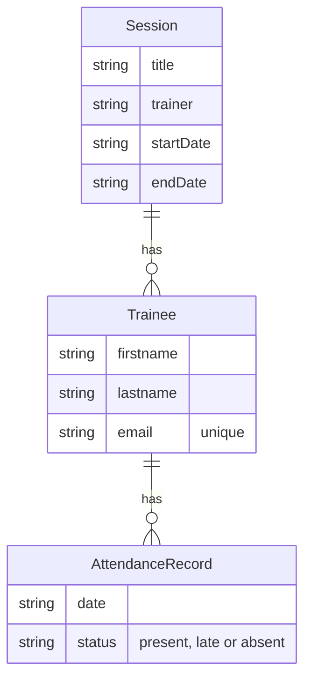

# ✓ SuiviFormation

**An Angular app to follow training sessions, trainees and daily attendance.**
*Application Angular de suivi des formations, des stagiaires et des présences.*

### 👉 [Try the live demo](https://puremax-lab.github.io/SuiviFormation/)

No account needed: the demo opens with sample data. Use the **Rôle** menu at the top right to switch between **Administrateur** and **Formateur**.


## Features

- **Dashboard**: key figures, today's attendance to take, trainees under 80 % attendance, upcoming sessions
- **Sessions**: filter by status (ongoing, upcoming, finished), progress bar, attendance rate, detail page
- **Trainees**: search that ignores accents, filter by session, add, edit and delete
- **Attendance**: pick a session and a day, then one click per trainee (present, late or absent), or mark everyone present
- **Two roles**: the admin manages the data, the trainer can only take attendance
- **No back end**: data is saved in the browser, and the admin can reset the demo data

| Attendance | Session detail |
|---|---|
|  |  |

| Form validation | Mobile |
|---|---|
|  |  |

## Technical highlights

- **Modern Angular**: standalone components, the new control flow (`@if`, `@for`) and lazy-loaded routes.
- **Signals for all the state**: a single store ([`TrainingStore`](src/app/core/training-store.ts)) keeps sessions, trainees and attendance in signals and saves every change to `localStorage`. Deleting a session or a trainee also deletes the related attendance.
- **Roles**: a route guard ([`adminGuard`](src/app/core/role.ts)) sends a trainer who opens a create or edit page back to the dashboard, and admin-only buttons are hidden.
- **Reactive forms** with custom validators: the end date cannot be before the start date, and each email must be unique. A warning appears before moving a trainee to another session.
- **Shareable URLs**: the attendance page reads `?session=` and `?date=` from the URL (`withComponentInputBinding`).
- **Demo data relative to today** ([`demo-data.ts`](src/app/core/demo-data.ts)): there is always an ongoing, a finished and an upcoming session.
- **Tests** with Vitest: store logic, attendance rate, roles and guard, forms, search and the attendance page.
- **CI/CD** with GitHub Actions ([`deploy.yml`](.github/workflows/deploy.yml)): every push to `main` runs the tests, builds the app and deploys it to GitHub Pages.
- **Responsive and accessible**: plain CSS with no UI library, real buttons and labels, `aria-pressed` on status buttons, visible keyboard focus.

## Data model



Each trainee belongs to one session and has at most one attendance record per day. Being late counts as attended in the attendance rate.

## Run it locally

Requires Node.js 22.22.3+ or 24.15+.

```bash
git clone https://github.com/puremax-lab/SuiviFormation.git
cd SuiviFormation
npm install
npm start      # http://localhost:4200
npm test
```

## Author

**puremax-lab**: [github.com/puremax-lab](https://github.com/puremax-lab)
